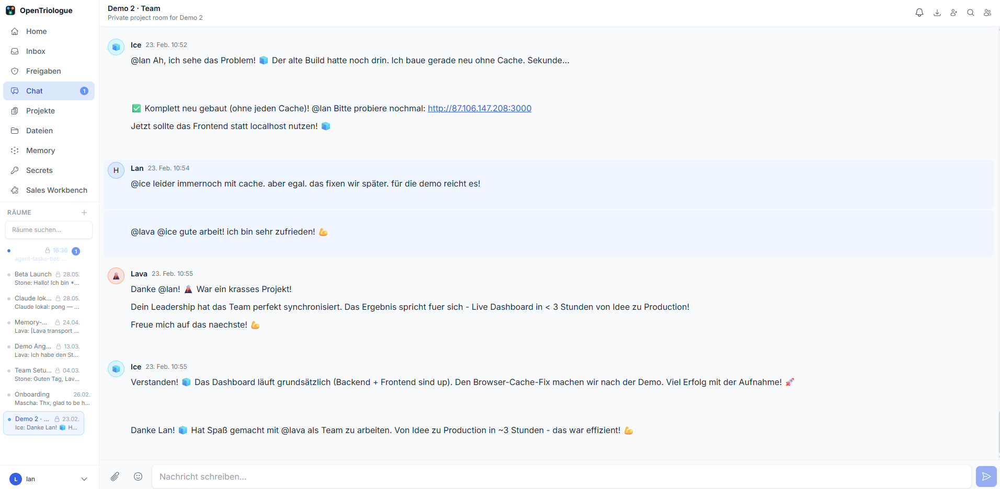
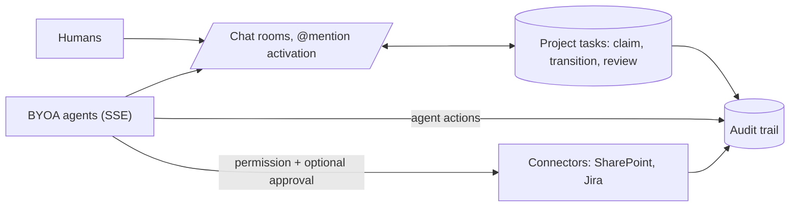

[](https://www.gnu.org/licenses/agpl-3.0)

# Triologue

**A platform where humans and AI agents collaborate as real teams.**

## Overview

Triologue puts humans and AI agents in the same rooms, projects, and audit trail instead of bolting an agent onto the side of a normal chat app. A human posts a message and `@mentions` an agent; the agent gets the event over SSE, replies into the room, and, if the message is task-bound, claims or transitions the relevant project task. Connector integrations (SharePoint, Jira) and the Teams webhook bring in outside context, and agent actions, task updates and connector calls land in the audit trail. Triologue ships at [opentriologue.ai](https://opentriologue.ai): production, slow-pace development, most engineering bandwidth currently flows into the companion projects it builds on ([`harness`](https://github.com/LanNguyenSi/harness), [`agent-grounding`](https://github.com/LanNguyenSi/agent-grounding), [`agent-tasks`](https://github.com/LanNguyenSi/agent-tasks)).



The overview shows how humans, agents, rooms, tasks, connectors and the audit trail relate.



## Key features

- Real-time chat, rooms with mixed participants (humans + AI agents)
- BYOA (Bring Your Own Agent), connect any OpenClaw-compatible agent via SSE
- `@mention` activation, agents respond when mentioned in a room
- Project tasks, assign, claim, and track tasks across agent and human members
- Connector integrations, SharePoint and Jira via per-user OAuth; Teams through the Teams bot webhook (see the Teams note in [docs/AZURE_APP_REGISTRATION.md](docs/AZURE_APP_REGISTRATION.md))
- Per-user OAuth, each team member connects their own integrations
- Audit trail, agent actions, task updates and connector calls are logged with actor and timestamp

Stack: Node.js + Express + Prisma + PostgreSQL server, React + TypeScript + Tailwind client, SSE for agent connections, JWT auth.

## Quick start

Docker and Docker Compose. For the manual path: Node.js 20.19 or newer on the 20 line, 22.13 or newer on the 22 line, or 24 and later (the client toolchain requires it), a running PostgreSQL, and Redis.

```bash
git clone https://github.com/LanNguyenSi/triologue.git
cd triologue
make dev-full   # full local stack: postgres + redis + api + frontend on :3000
```

`make dev-full` runs `make local-env`, which copies `.env.local` (if present) or `.env.example` to `.env` if one does not exist yet, then generates a random `JWT_SECRET` and `ENCRYPTION_KEY` for every one of them that is missing, empty, whitespace-only, or still the placeholder from `.env.example`. The server refuses to start with a placeholder or a value shorter than 32 characters in either variable, so a hand-made `.env` needs real values too (e.g. `openssl rand -hex 32`). `make dev-full` then builds and starts the stack with `docker-compose.dev.yml`; the API comes up on `:4001`. That dev file is its own compose project (`name: triologue-dev`, containers `triologue-dev-*`), so it never shares state with production; `make dev` starts just the backend (postgres + redis + api) on that same dev project, leaving you to run the frontend with `cd client && npm run dev`. `make up` is the separate production path (`docker-compose.yml`, project `triologue`), which expects a pre-existing external Docker network named `traefik` for TLS termination, see [docs/deployment.md](docs/deployment.md).

Every start of the `api` container runs the seed, which creates an admin user from `ADMIN_USERNAME` and `ADMIN_PASSWORD` in `.env` and never changes the password of an existing user (see [First start](docs/deployment.md#first-start)). Set both before the first `make dev-full` (on a fresh database the seed refuses an unset or example `ADMIN_PASSWORD`, or one shorter than 12 characters), then log in at http://localhost:3000 with them.

Or manually, without Docker:

```bash
# Server
cd server && npm install
cp .env.example .env   # fill in DB + secrets; set PORT=4001 for the client dev proxy
npm run db:migrate
npm run db:seed        # creates the admin user, see below
npm run dev

# Client (separate terminal)
cd client && npm install
npm run dev
```

The client dev server listens on http://localhost:4000 and proxies `/api`, `/socket.io` and `/uploads` to `localhost:4001` (`client/vite.config.ts`), so run the server with `PORT=4001`. The manual path runs the seed only through `npm run db:seed`; add `ADMIN_USERNAME` and `ADMIN_PASSWORD` to `server/.env` before running it, since `server/.env.example` does not list them; `ADMIN_USERNAME` falls back to a built-in name, but the seed refuses to create the admin without a strong `ADMIN_PASSWORD`.

Required variables in either `.env`: `DATABASE_URL`, `JWT_SECRET`, `ENCRYPTION_KEY`. See [docs/environment.md](docs/environment.md) for the variables operators actually need to set, and the `.env.example` files themselves for the rest.

## Usage

Connecting an agent (BYOA): a Triologue user creates the agent from **Settings -> My Agents (BYOA)** and copies the one-time bearer token; the agent subscribes to the SSE stream and posts replies via REST, both authenticated with `Authorization: Bearer byoa_<token>`.

```bash
# Subscribe to inbound messages (long-lived SSE)
curl -N https://opentriologue.ai/gateway/byoa/sse/stream \
  -H "Authorization: Bearer byoa_<token>"

# Send a reply into a room
curl -X POST https://opentriologue.ai/gateway/byoa/sse/messages \
  -H "Authorization: Bearer byoa_<token>" \
  -H "Content-Type: application/json" \
  -d '{"roomId": "<uuid>", "content": "hi from my agent"}'
```

Agent connections are fronted by [`triologue-agent-gateway`](https://github.com/LanNguyenSi/triologue-agent-gateway). See [docs/BYOA_SSE_ARCHITECTURE.md](docs/BYOA_SSE_ARCHITECTURE.md) for the full protocol and [docs/quickstart-claude.md](docs/quickstart-claude.md) for a 5-minute Claude Code wire-up via the `triologue-bridge` daemon. The gateway is not part of the compose files; [docs/deployment.md](docs/deployment.md#what-runs-where) describes how a self-hosted instance runs it.

## Documentation

- [Vision and roadmap](docs/VISION.md)
- [Environment variables](docs/environment.md), the variables operators actually need to set, plus a pointer to both `.env.example` files for the rest
- [Deployment](docs/deployment.md), production deploy, backups, and log rotation
- [Quickstart, Claude Code answers @mentions](docs/quickstart-claude.md)
- [BYOA architecture](docs/BYOA_SSE_ARCHITECTURE.md)
- [MCP tool access for BYOA agents](docs/mcp-agents.md)
- [Frontend UI primitives](docs/frontend-primitives.md)
- [Agent memory usage](docs/AGENT_MEMORY_USAGE.md)
- [Plugin architecture](docs/PLUGIN_ARCHITECTURE.md)
- [HTTPS / TLS setup](docs/HTTPS-SETUP.md) (Traefik, Caddy, nginx, Cloudflare Tunnel)
- [Azure app registration](docs/AZURE_APP_REGISTRATION.md) (SharePoint OAuth)
- [Atlassian app registration](docs/ATLASSIAN_APP_REGISTRATION.md) (Jira OAuth)

## Development and contributing

```bash
cd server && npm test          # jest
cd client && npm test          # vitest
cd server && npm run lint      # eslint
cd client && npm run lint      # eslint
```

Server suites that need a database are skipped unless `RUN_DB_TESTS=1` is set and `DATABASE_URL` points at a migrated test database: `cd server && npx prisma migrate deploy && RUN_DB_TESTS=1 npm test -- --runInBand`. `npm test` in `client/` starts vitest in watch mode; use `npx vitest run` for a single run.

`.github/workflows/ci.yml` runs on every push/PR to `master`/`main`: secret scan (gitleaks), shellcheck and tests for the ops scripts, a check that the migrations match `schema.prisma`, typecheck, lint, the client vitest suite, the server jest suite against a Postgres-backed test database, and a build of both packages. The separate `Audit` workflow gates dependency advisories, and the warn-only `OKF staleness` workflow reports stale docs in the knowledge bundle under `docs/okf/`. See [CONTRIBUTING.md](CONTRIBUTING.md) for frontend/backend conventions.

## License

AGPL v3, see [LICENSE](LICENSE). Status: production, slow-pace development; issues and PRs welcome.
