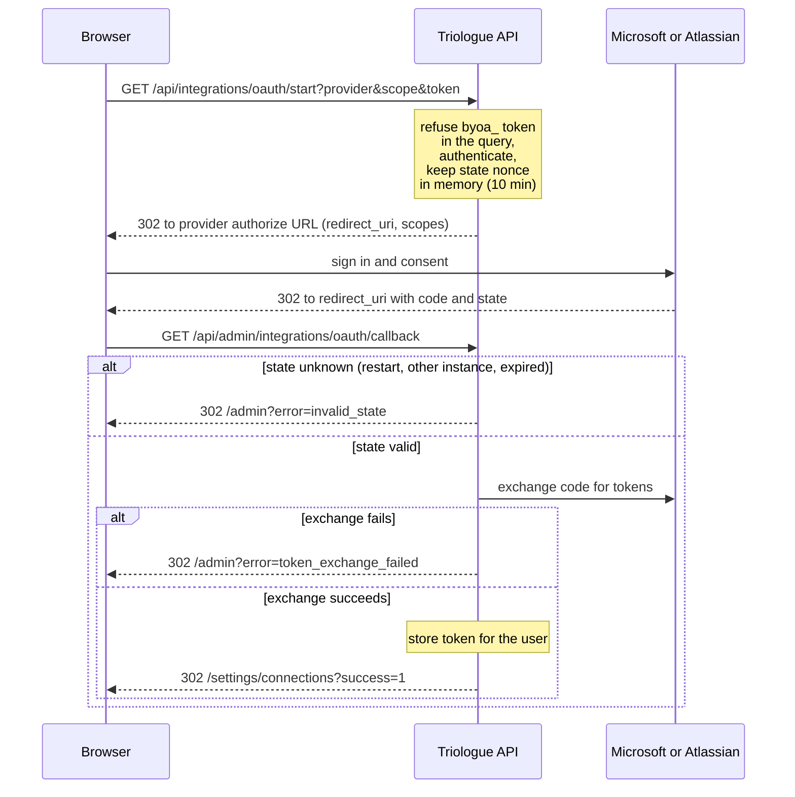

# Microsoft Entra ID App Registration Guide

> **TL;DR:** Step-by-step Entra ID (formerly Azure AD) app registration for connecting Triologue to Microsoft Graph through the SharePoint connector. Callback URL is `${APP_URL}/api/admin/integrations/oauth/callback`. Required scopes: `Files.ReadWrite.All`, `Sites.Read.All`, `offline_access`. Set `MICROSOFT_CLIENT_ID`, `MICROSOFT_CLIENT_SECRET`, `MICROSOFT_TENANT_ID`, `MICROSOFT_REDIRECT_URI` in `.env`, then connect from Settings.

To let Triologue connect to Microsoft services (SharePoint; see the Teams note in Step 3), you need an App Registration in Microsoft Entra ID (formerly Azure AD). That is Triologue's "identity" towards Microsoft.

**Time required:** about 10 minutes
**Prerequisite:** admin access to entra.microsoft.com

---

## Step 1: Create the app registration

1. Open https://entra.microsoft.com
2. In the left sidebar, go to **Entra ID**, then **App registrations**
3. Click **"New registration"**

**Fill in:**
- **Name:** `OpenTriologue`
- **Supported account types:** `Accounts in this organizational directory only` (Single tenant)
  - Use multi-tenant only if other organisations should also connect
- **Redirect URI:**
  - Platform: **Web**
  - URI: `https://<your-host>/api/admin/integrations/oauth/callback`

4. Click **"Register"**

The redirect URI must equal `MICROSOFT_REDIRECT_URI` exactly; when that is unset, Triologue uses `${APP_URL}/api/admin/integrations/oauth/callback`.

---

## Step 2: Create a client secret

1. In the new app, in the left sidebar, click **"Certificates & secrets"**
2. Click **"New client secret"**
3. Description: `Triologue Production`
4. Expiry: **24 months**
5. Click **"Add"**

⚠️ **Copy the "Value" right away!** It is shown only once.

You now have:
- **Client ID** (on the overview page, "Application (client) ID")
- **Client Secret** (the value you just copied)
- **Tenant ID** (on the overview page, "Directory (tenant) ID")

---

## Step 3: Set API permissions

1. In the left sidebar, click **"API permissions"**
2. Click **"Add a permission"**, then **"Microsoft Graph"**, then **"Delegated permissions"**

**For SharePoint** (connector scope `graph`):
- `Files.ReadWrite.All`: read and write files
- `Sites.Read.All`: read SharePoint sites

**General:**
- `User.Read`: read own profile (default, usually already there)
- `offline_access`: receive a refresh token (required for auto-refresh)

3. Click **"Grant admin consent for [Organisation]"**
   - This skips the user-consent dialog for everyone in the org

**Note on Teams:** Teams sync is not connected through this OAuth flow: no connector requests the Teams scopes (`Team.ReadBasic.All`, `ChannelMessage.Read.All`, `ChannelMessage.Send`). Teams sync also needs `TEAMS_BOT_SECRET`, the webhook `POST /api/teams/webhook` and admin channel mappings under `/api/teams/mappings`, which are kept in server memory.

---

## Step 4: Configure Triologue

Set these four values in `.env`:

```env
MICROSOFT_CLIENT_ID=<Application (client) ID>
MICROSOFT_CLIENT_SECRET=<Client Secret Value>
MICROSOFT_TENANT_ID=<Directory (tenant) ID>
MICROSOFT_REDIRECT_URI=https://<your-host>/api/admin/integrations/oauth/callback
```

Set `MICROSOFT_TENANT_ID` for a single-tenant registration; when it is unset, Triologue uses `common`.

Then restart the API and connect from Settings (see Step 5).

---

## Step 5: Connect

Sign in as a human user, open Settings, Connections (`/settings/connections`) and click Connect on the connector. After consent you return to `/settings/connections?success=1`. The token is stored for the user who connected.

The sequence below shows the OAuth round trip: where the redirect URI is used and where the `invalid_state` and `token_exchange_failed` errors come from.



---

## Jira

For Jira, see [Atlassian app registration](ATLASSIAN_APP_REGISTRATION.md).

---

## Troubleshooting

**"AADSTS50011: The redirect URI does not match"**
The redirect URI in Azure does not match `MICROSOFT_REDIRECT_URI`. Compare them exactly (watch out for a trailing slash).

**"AADSTS65001: The user or administrator has not consented"**
Admin consent is missing. Go back to API permissions and click "Grant admin consent".

**"AADSTS7000218: The request body must contain client_secret"**
The client secret is missing or expired. Create a new one.

**Token refresh fails**
The `offline_access` scope is missing. Add it under API permissions afterwards and grant admin consent.

**`/admin?error=invalid_state`**
The API restarted, another API instance served the callback, or more than about 10 minutes passed between Connect and the callback. The state is kept in the memory of one API process; start again with a single API instance.

**`/admin?error=token_exchange_failed`**
The client secret or the redirect URI does not match; the `detail` parameter carries the start of Microsoft's answer.

**`500 Microsoft OAuth not configured`**
`MICROSOFT_CLIENT_ID` is unset.
