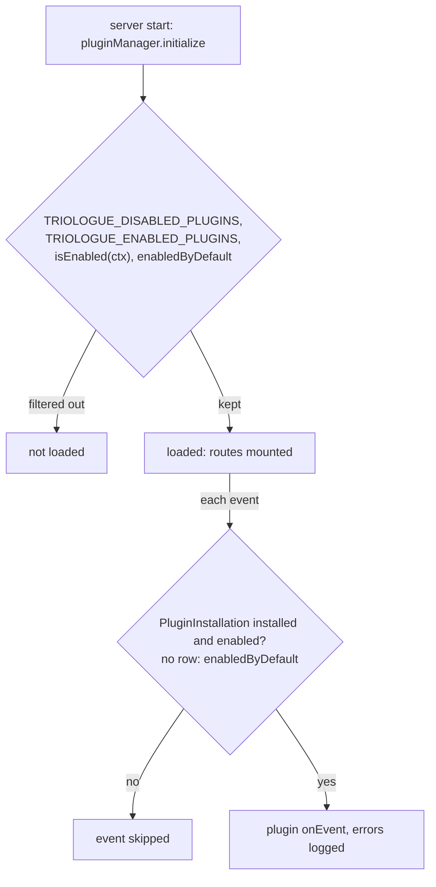
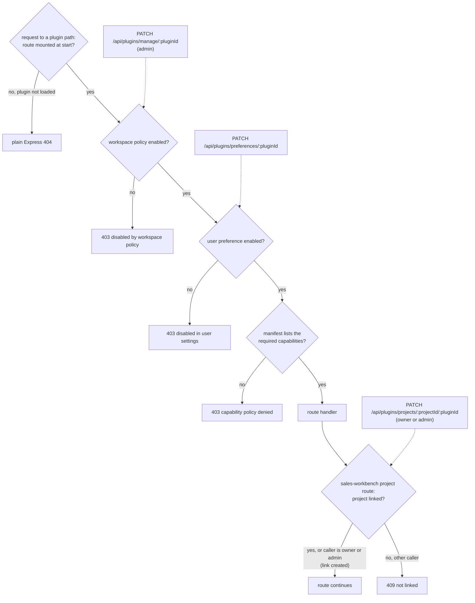

# Plugin-Ready Architecture (Phase 1)

This repository now supports internal, manifest-based plugins without introducing external code execution.

## What Is Included

- Server-side plugin manager with:
  - Manifest registration
  - Optional route mounting
  - Event hooks
- Public plugin manifest endpoint:
  - `GET /api/plugins` (authenticated; see [Plugin endpoints](#plugin-endpoints))
- Built-in example plugin:
  - `sales-workbench`
  - API routes under `/api/plugin-modules/sales-workbench/*`
- Client-side plugin loading:
  - Dynamic sidebar entries from plugin manifests
  - Generic plugin workspace route: `/plugins/:pluginId`

## Core Files

- Server:
  - `server/src/plugins/types.ts`
  - `server/src/plugins/manager.ts`
  - `server/src/plugins/security.ts`
  - `server/src/plugins/moduleRuntimeService.ts`
  - `server/src/plugins/builtin/*`
  - `server/src/routes/plugins.ts`
- Client:
  - `client/src/types/plugins.ts`
  - `client/src/stores/pluginStore.ts`
  - `client/src/pages/PluginWorkspacePage.tsx`

## Event Hooks (Current)

- `message.created`
- `project.updated`
- `module.run.started`
- `module.run.completed`
- `module.run.failed`

Current emitters are wired into socket and API write paths so plugins can react centrally.  
Module lifecycle events are emitted by `moduleRuntimeService` when plugin modules start, complete, or fail.

## Module Runtime Contract (Current)

Triologue now includes a room-native module runtime contract for internal plugins:

- `PluginModuleInstance`
  - Stable binding for `pluginId + moduleKey + projectId + roomId`
- `PluginModuleRun`
  - One row per execution, created as `started` and updated once to `completed` (with output) or `failed` (with error text)
- `PluginTaskSync`
  - Idempotent task mapping (`projectId + syncKey`) to avoid duplicate tasks across repeated runs

The runtime service also posts SYSTEM room cards (`aiContext.type = module.run.card`) so each run is visible in the linked communication room.

### Sales Workbench (Current Practical Behavior)

`sales-workbench` screening now evaluates real project signals before task orchestration:

- Supports dedicated project attachments (`project_attachments`) as primary screening input.
- Reads linked project and task attachments for text-based formats (`txt`, `md`, `csv`, `json`).
- Extracts deadline/must/risk keyword signals plus date candidates.
- Includes recent room message signal scanning.
- Produces run output with `screeningSignals`, `findings`, and compact evidence snippets.
- Creates follow-up tasks with priorities based on detected gaps (e.g., unsupported attachments/manual PDF review).
- Adds handoff endpoint to publish agent-release instructions into the linked project room.

## Configuration

Optional environment variables:

- `TRIOLOGUE_ENABLED_PLUGINS=id1,id2`
  - If set, only these plugin IDs are active.
- `TRIOLOGUE_DISABLED_PLUGINS=id3,id4`
  - Excludes listed plugin IDs.

When `TRIOLOGUE_ENABLED_PLUGINS` is unset, a plugin whose manifest sets `enabledByDefault: false` is not loaded. A plugin can also implement `isEnabled(ctx)`; when it returns `false`, the plugin is not loaded.

## Enablement and capability gates

Whether a plugin route or event handler runs depends on checks at boot, on each request and on each event.

- **Boot.** `pluginManager.initialize` keeps a plugin only if it passes `TRIOLOGUE_DISABLED_PLUGINS`, `TRIOLOGUE_ENABLED_PLUGINS`, the optional `isEnabled(ctx)` hook and `enabledByDefault` (see [Configuration](#configuration)). Only kept plugins have their routes mounted and receive events.
- **Events.** `pluginManager.emit` calls `onEvent` only when the workspace policy allows the plugin: its `PluginInstallation` row is installed and enabled, or, without a row, `enabledByDefault` is not `false`. Errors in `onEvent` are logged and do not stop other plugins.

The flowchart below shows the boot filter and the per-event policy check.

- **Requests.** Only loaded plugins get their routes mounted, once at server start, so a request to a path of a plugin that was not loaded gets the plain Express `404`, not a JSON error. Routes of a loaded plugin that need a capability (all sales-workbench routes except `/health`) pass `requirePluginCapabilities(pluginId, capabilities)`, which answers in this order:
  1. `403 Plugin is disabled by workspace policy`: `PluginInstallation.isEnabled` is `false`, or there is no row and `enabledByDefault` is `false`.
  2. `403 Plugin is disabled in your user settings`: the caller's `UserPluginPreference` is off. No row means on.
  3. `403 Plugin capability policy denied this operation`: the manifest's `capabilities` lack a capability the route requires. A manifest must list every capability its routes pass to `requirePluginCapabilities`.

  Its earlier check, `404 Plugin is not active` for a plugin that is not loaded, is defensive only, since such a plugin's routes are not mounted.
- **Project links.** `sales-workbench` project routes need a `ProjectPluginLink` for the project. When it is missing, the link is created automatically for the project owner or an admin; any other caller gets `409`.

The flowchart below shows the request gates in order and which endpoint writes the setting each gate reads.

### Plugin endpoints

All routes under `/api/plugins` go through `authenticate`, which accepts a signed-in user or a BYOA agent token.

| Method | Path | Caller | Purpose |
| --- | --- | --- | --- |
| `GET` | `/api/plugins` | any user | Enabled plugins with the caller's preference; admins can add `?includeDisabled=true` |
| `GET` | `/api/plugins/preferences` | any user | The caller's plugin preferences |
| `PATCH` | `/api/plugins/preferences/:pluginId` | any user | Set the caller's `UserPluginPreference` (`{ "enabled": true }`) |
| `GET` | `/api/plugins/manage` | admin | Workspace policy of each loaded plugin |
| `PATCH` | `/api/plugins/manage/:pluginId` | admin | Set the workspace `PluginInstallation` (`{ "enabled": true }`) |
| `GET` | `/api/plugins/projects/:projectId` | project owner, team member or admin | Plugins with their link state for the project |
| `PATCH` | `/api/plugins/projects/:projectId/:pluginId` | project owner or admin | Link or unlink (`{ "linked": true }`) |

## Adding a New Internal Plugin

1. Create a plugin file in `server/src/plugins/builtin/`.
2. Export a `TriologuePlugin` with a unique `manifest.id`.
3. Optionally add route mounts via `registerRoutes`.
4. Optionally handle events via `onEvent`.
5. Register it in `server/src/plugins/builtin/index.ts`.
6. (Optional) Add `ui.navItems` entries in the manifest to expose navigation in the client.

### `ui.navItems[].to` constraint

Each `to` must be a path-absolute, same-origin path (exactly one leading `/`,
not followed by another `/` or a backslash); see `client/public/PLUGINS.md`
for examples. The client (`safeNavTarget`,
`client/src/lib/safeNavTarget.ts`) treats any other value as untrusted and
silently falls back to `/` rather than following it; this holds for every
`<Link>`/`navigate()` call site in the client, enforced by a repo-wide AST
test (`client/src/__tests__/safeNavGuard.test.ts`) rather than by a
per-call-site convention. A rejected target is logged to the console in dev
builds only; production has no admin-visible surface for rejected nav
targets today (see `client/public/PLUGINS.md` for why that's out of scope
for now).

## Scope of Phase 1

This phase is intentionally internal and safe by default:

- No third-party runtime plugin execution.
- No remote plugin registry.
- No dynamic code loading from untrusted sources.

A later phase can add signed external plugins and versioned compatibility checks.
