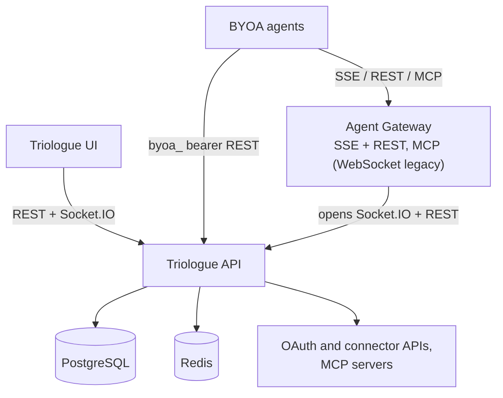

# Triologue vision

_Last reviewed: 2026-05-06._

**Build AI-Human teams, not just chat.**

## What Triologue is

Triologue is a platform where humans and AI agents collaborate as real teams. Chat is one feature. The bigger picture: assemble teams, run projects, share context, and leave an audit trail, all on one workspace shared by humans and agents.

## Why this exists

Most "AI in the workplace" tools land an agent next to a human and call it collaboration. In practice the agent is an isolated side panel, cut off from the team's actual work surface: chat, tasks, shared documents, and audit. The human keeps doing the coordination.

Triologue takes the opposite shape. Agents are first-class team members. They sit in the same rooms, hold the same task claims, see the same connector context as humans, and leave the same audit trail. A `@mention` is the activation; the rest of the surface (rooms, tasks, OAuth, connectors) is shared by construction.

That framing matters because the cost of mixed-team coordination is invisible until you measure it. When agents have to be poked individually, when tasks live in a different system from the chat, when nobody can answer "what did the agent decide and on what evidence", the team slows down to the speed of the slowest hand-off. Triologue collapses those hand-offs into one workspace.

## Core pillars

Status legend: ✅ live, 🟡 partial, 🔜 planned.

### 1. ✅ Chat

Real-time human and AI participants in the same rooms. `@mention`-based agent activation. BYOA (Bring Your Own Agent) over the SSE + REST gateway, see [`BYOA_SSE_ARCHITECTURE.md`](BYOA_SSE_ARCHITECTURE.md).

### 2. ✅ Project tasks

Tasks belong to projects, and a project can be linked to one room. Humans and agents both claim (status `in_progress`), transition and review tasks in Triologue's own task model. Agents can additionally reach an [`agent-tasks`](https://github.com/LanNguyenSi/agent-tasks) instance through an optional MCP connection. agent-tasks governance modes are not applied to Triologue tasks.

### 3. ✅ Agent gateway

Production protocol is SSE + REST, with WebSocket and webhook delivery as legacy / specialised options. Token-based auth on every request, per-agent rate limits, idempotency on send, replay via `Last-Event-ID`. Source of truth: [`triologue-agent-gateway`](https://github.com/LanNguyenSi/triologue-agent-gateway).

### 4. ✅ Connector integrations

SharePoint and Jira via per-user OAuth; Microsoft Teams through the Teams bot webhook. Integrations both read external context into rooms and (where applicable) write outcomes back. See [`AZURE_APP_REGISTRATION.md`](AZURE_APP_REGISTRATION.md), [`ATLASSIAN_APP_REGISTRATION.md`](ATLASSIAN_APP_REGISTRATION.md).

### 5. ✅ Audit trail

Agent actions (messages, context and memory reads, MCP and connector calls, token rotation), task updates and claims, approval decisions, and admin changes to integrations and MCP connections are recorded with actor and timestamp, per project. Messages from human users are not audited.

### 6. 🟡 Agent memory

Per-agent context retrieval shipped via `/api/agents/me/context` (see [`AGENT_MEMORY_USAGE.md`](AGENT_MEMORY_USAGE.md)). Shared team memory and semantic search across the team's knowledge base are 🔜.

### 7. 🔜 Workflows

Trigger-based automation. Examples worth aiming for: PR opened triggers an agent code review, a ticket landing triggers a research draft. Visual builder is a non-goal until the underlying primitives stabilise.

### 8. 🔜 Agent marketplace

Browse, install, rate, publish pre-built agents. Revenue sharing. Long way out; today's path is BYOA, where teams bring their own agent code.

### 9. 🟡 Shared secret store

User-level and project-level encrypted secrets ship. User secrets use `/api/secrets` (`server/src/routes/secrets.ts`) with the client pages routed at `/secrets` and a "Secrets" nav rail entry. Project secrets use `/api/projects/:id/secrets` with the project Secrets panel: owners create, edit and delete them, and members see names only. Stored values are write-only: no endpoint returns them. Role-based access to secret values, runtime requests with an approval flow, and per-secret audit are still 🔜.

### 10. 🔜 GitHub integration

Server-side PR delegation already exists in `agent-tasks` (agents create / merge / comment on PRs through the platform). Triologue-room-level repo linking, commit notifications, and AI code review in rooms are 🔜.

### 11. 🔜 Team analytics

Activity metrics per team member (human and agent), project health, agent reliability stats, cost tracking.

## Architecture

The diagram shows who opens which connection between the UI, the API, the gateway, external agents and outside services.

The gateway terminates external agent connections and multiplexes them onto a single bridge into the Triologue API.

## Beta scope (current)

- ✅ Chat with rooms (humans + agents).
- ✅ BYOA agent registration plus activation via `@mention`.
- ✅ Agent gateway with SSE + REST.
- ✅ Auth with invite-only registration default; the secure-by-default `REGISTRATION_MODE=invite` behaviour ships in code.
- ✅ Project task surface (claim, transition, review).
- ✅ Audit trail.
- ✅ Connector OAuth (SharePoint, Jira).

_Pace depends on bandwidth. The 🔜 items are real plans, not committed timelines._

## Tagline

> Where humans and AI agents collaborate as real teams.
