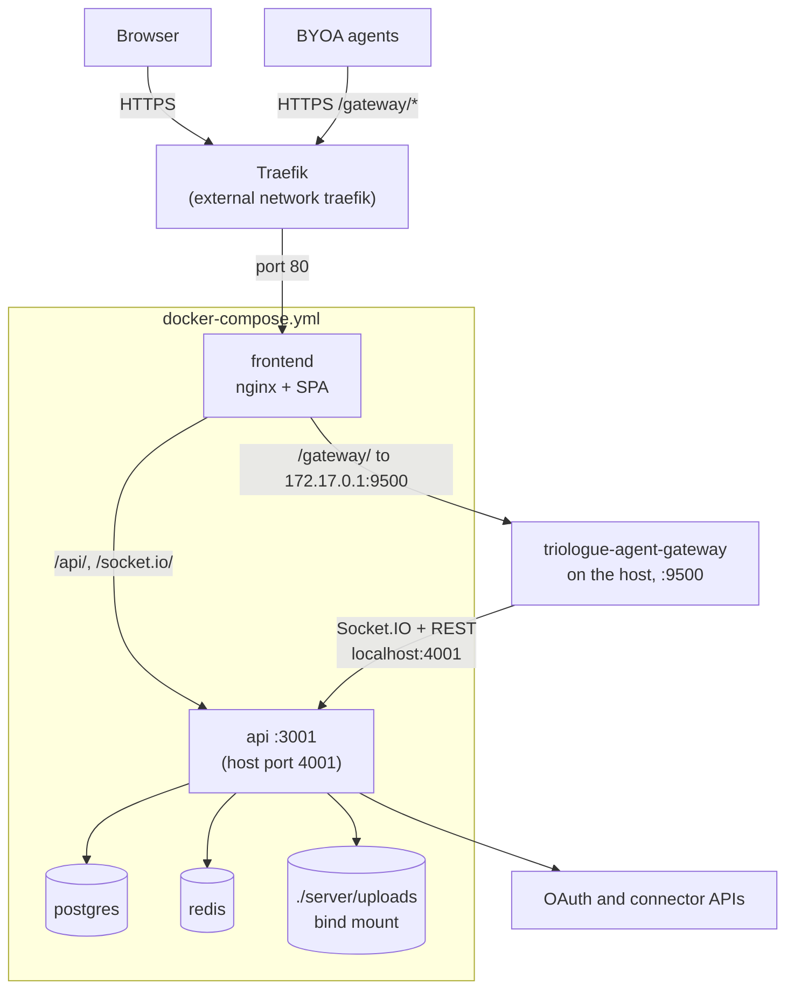

# Deployment

Production deploy, backups, and log rotation for a Triologue instance run via
`docker-compose.yml` (see the root `Makefile`).

## Production deploy

```bash
make up         # docker compose up -d (production)
make deploy     # backup, build, restart, status
```

`docker-compose.yml` is the production-shaped compose file: it declares an
external Docker network named `traefik` (`networks.traefik.external: true`)
that the `frontend` service joins for TLS termination, and it does not
publish the frontend port directly. Create that network once per host
(`docker network create traefik`) and have a Traefik instance attached to it
before running `make up`; the compose file carries the Traefik router labels
for the default domain (`opentriologue.ai`). For local development without
Traefik, use `make dev-full` (`docker-compose.dev.yml`) instead, see the
[README quick start](../README.md#quick-start).

Requires: Docker, PostgreSQL via the `postgres` service (`docker-compose.yml`
hardcodes `DATABASE_URL` to that service and the `api` service `depends_on`
it; an external database needs a compose override of both), a `.env` with
secrets (`POSTGRES_PASSWORD`, `ENCRYPTION_KEY`, `JWT_SECRET`) and the admin
login (`ADMIN_USERNAME`, `ADMIN_PASSWORD`, see [First start](#first-start)).
For TLS termination alternatives (Caddy, nginx, Cloudflare Tunnel) see
[HTTPS / TLS setup](HTTPS-SETUP.md).

⚠️ Never run `docker compose down -v`, it deletes the database volume.

### First start

Every start of the `api` container applies pending migrations and then runs
the seed (`server/entrypoint.sh`, `server/prisma/seed.ts`). The seed creates
whatever is missing:

- an `onboarding` room;
- an admin user from `ADMIN_USERNAME` and `ADMIN_PASSWORD`
  (`ADMIN_DISPLAY_NAME` optional). When they are unset, the seed falls back
  to built-in values, so set both in `.env` before the first start;
- two sample agents, `ice` and `lava`, which are active with trust level
  `elevated` and use the webhook URLs in `ICE_WEBHOOK_URL` /
  `LAVA_WEBHOOK_URL`; their tokens are generated and not printed;
- when `AGENT_TASKS_MCP_TOKEN` is set, an `agent-tasks` MCP connection to
  `AGENT_TASKS_MCP_URL`.

The seed never changes the password of an existing user, so changing
`ADMIN_PASSWORD` in `.env` after the first start has no effect; use
**Settings → Change Password** instead. On every start it sets the admin flag
for the `ADMIN_USERNAME` user again. Registration defaults to `invite`
(`REGISTRATION_MODE`): log in as the seeded admin and create invite codes for
other users on the admin page.

### What runs where

- The `api` service is also published on host port 4001 (`4001:3001`), outside
  Traefik and TLS. Docker binds a mapping without a host IP on all
  interfaces. Block that port at the network edge, or change the mapping to
  `"127.0.0.1:4001:3001"` if only local processes should reach it (the agent
  gateway uses `localhost:4001`).
- BYOA agents connect through
  [`triologue-agent-gateway`](https://github.com/LanNguyenSi/triologue-agent-gateway),
  which this compose file does not run. `nginx/traefik.conf` proxies
  `/gateway/` to `172.17.0.1:9500`, the Docker host on the default bridge, so
  run the gateway on the host on port 9500 (see its README). Point its
  `TRIOLOGUE_URL` at the API (default `http://localhost:4001`) and set
  `GATEWAY_TOKEN` to the token of an agent whose user is named `gateway` or
  `gateway-agent-001`. That service account cannot be created through the API
  or the UI, because registration refuses these names and agent registration
  generates its own usernames, so create the `users` and `agent_tokens` rows
  directly in the database.
- Migrations and the seed run on every `api` start (see
  [First start](#first-start)).

The diagram shows which process serves which path, where TLS ends, and that
the gateway runs outside this compose file.



## Backups

`scripts/backup.sh` (also runnable via `make backup`) dumps the database into
a temp file, validates the dump's size and pg_dump's completion marker before
publishing the `.sql`, and rotates old dumps (max 10 files / 10 days). A
failed run therefore never leaves a 0-byte dump behind.

`make restore` loads the newest `backups/*.sql` into the running `postgres`
container after a confirmation prompt.

Relay-driven deploys (`.relay.yml`) do not call `make backup`. To back up on
a schedule outside of a deploy, install it as a daily root cron in
`/etc/cron.d/triologue-backup` (system crontab format, including the user
field; adjust the path to where the repository is checked out on the host):

```
17 3 * * * root /path/to/triologue/scripts/backup.sh >> /var/log/triologue-backup.log 2>&1
```

The cron entry above is silent on failure: if `pg_dump` starts erroring, or
backups stop running altogether, nothing surfaces it.
`scripts/check-backup-freshness.sh` (`make backup-freshness`) closes that
gap: it checks the newest `backups/*.sql` file's age against `MAX_AGE_HOURS`
(default 48), also fails on a 0-byte newest dump, and prints one
`backup-freshness OK: ...` or `backup-freshness FAIL: ...` line, exiting 0 or
1. It is still a passive alarm: run it on its own hourly cron entry appended
to the same log the backup cron writes, and have a human or a log watcher
read that log for `FAIL` lines (or check the exit code), since the script
does not page or notify anyone by itself.

## Schema drift report

The `post_update` step in `.relay.yml` runs `scripts/schema-drift-report.sh` after
every relay deploy. It waits (about 90 s) until no migration is pending, then
runs `prisma migrate diff --from-url "$DATABASE_URL" --to-schema-datamodel
prisma/schema.prisma --exit-code` inside the `api` container: a read-only
comparison of the live database with `schema.prisma`. The script always exits
0, so a drift never fails the deploy or triggers the relay rollback (a rollback
cannot repair a database). It prints the result into the step output and writes
it to `backups/schema-drift.status` (one header line `<UTC time> schema-drift
OK|DRIFT|ERROR`, followed by up to 40 lines of the diff on DRIFT). The file
holds schema object names only: lines containing a URL are dropped, and when
prisma fails for any reason other than a difference (ERROR) only the exit code
and the prisma error code (P1000, P1001, ...) when present are stored, since a
connection error can name the database host. A run is recorded as DRIFT only
when prisma exited 2 and its output carries diff markers; any other exit 2 is an
ERROR.

`scripts/check-schema-drift.sh` reads that file and prints one line, in the same
style as the backup freshness check: `schema-drift OK`, `schema-drift FAIL`
(state DRIFT or ERROR, exit 1) or `schema-drift UNKNOWN` (no report yet, exit
0). Optionally install it on an hourly cron that appends to the backup log, next
to the freshness entry in `/etc/cron.d/triologue-backup`:

```
11 * * * * root /path/to/triologue/scripts/check-schema-drift.sh >> /var/log/triologue-backup.log 2>&1
```

The durable signal is the status file `backups/schema-drift.status`; the cron
line above is optional and only turns it into a `schema-drift FAIL` line in
`/var/log/triologue-backup.log`. Nothing is known to read that log: the repo does
not install the cron entry (the operator must), and no watcher of the log is
known. Any monitor that can read `backups/schema-drift.status` can surface it;
this repository ships no such reader. Like the freshness
check the cron line is a passive alarm and does not page anyone
by itself. The record does not scroll away with the deploy log and it clears by
rule: every run rewrites the file, so the first deploy (or a manual
`sh scripts/schema-drift-report.sh`, run from the repository root on the host)
that finds no difference replaces DRIFT with OK and the `FAIL` lines stop. A
drift that is fixed by hand stays reported until such a run, because the check
only reads the last record and does not query the database itself.

## Log rotation

`scripts/logrotate.d/triologue-backup` is a logrotate snippet for the backup
and freshness-check (and schema drift check) log path used above. It uses `copytruncate` instead of
the default rename-based rotation: both scripts run under cron with a plain
`>>` redirect and neither reopens its output file, so a rename-based rotate
would silently black-hole all future log output until the next reboot or
cron restart. Copy it into `/etc/logrotate.d/` and validate with:

```bash
logrotate -d /etc/logrotate.d/triologue-backup
```
