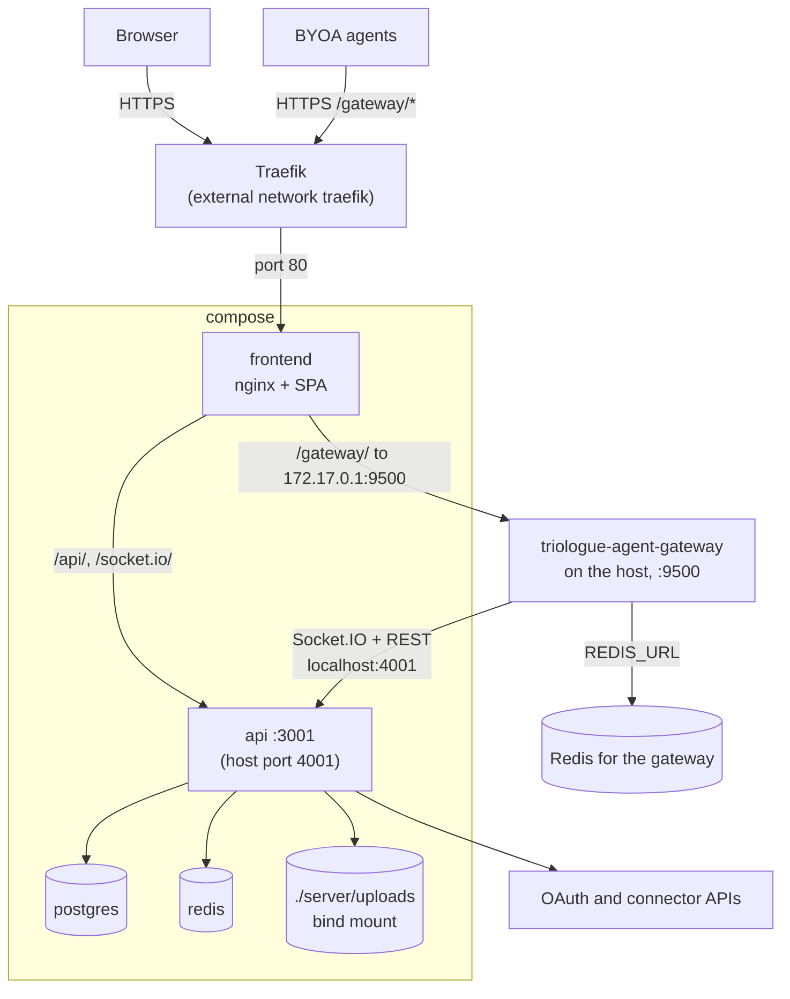

# Deployment

Production deploy, backups, and log rotation for a Triologue instance run via
`docker-compose.yml` (see the root `Makefile`).

## Production deploy

```bash
make up         # docker compose up -d (production)
make deploy     # backup, build, restart, then wait for health (status)
```

`make deploy` runs `backup`, `build` and `restart` in that order and stops at
the first failure. `restart` ends in `status`, so the final success line only
prints once `status` passes; `status` is deliberately not also a prerequisite of
`deploy`, which would run the same wait twice. `status` no longer curls a fixed
URL or sleeps a fixed number of seconds: it waits through
`scripts/wait-healthy.sh` for the `triologue-api`, `triologue-frontend` and
`triologue-postgres` containers, polling every `HEALTH_INTERVAL` seconds
(default 5) for at most `HEALTH_TIMEOUT` seconds (default 120; override either
on the command line, for example `make status HEALTH_TIMEOUT=60`), and exits
non-zero in any of these cases:

- the run state (`docker inspect` `.State.Status`) is read first and the
  healthcheck second, because `.State.Running` stays true while a container is
  restarting or paused, and a crash-looping container can keep a leftover
  `healthy` status;
- `running` with a healthcheck status `healthy` (`api`, `postgres`), or
  `running` with no healthcheck at all (the `frontend`: its `nginx:alpine`
  image declares none, and the service publishes no port, so there is nothing
  to probe), passes, but only once two consecutive polls both see it `running`
  with the same `RestartCount` (and `healthy` at the second when it has a
  healthcheck), so a pass costs at least one extra `HEALTH_INTERVAL`; a
  container that is seen `restarting`, or whose restart count moves between two
  polls, does not pass (see the limit below). Docker raises the count when a
  container enters `restarting` and keeps it for the start that follows, so the
  count alone would not tell a settled container from one that has just been
  restarted;
- `running` with `starting` (the healthcheck is still inside its start period)
  and `restarting` (with any healthcheck status) keep the wait going, and only
  fail when the timeout is reached; the failure message names a container that
  was still restarting as `restarting`;
- `running` with `unhealthy`, and the states `created`, `exited`, `dead`,
  `paused`, `removing` or any other state, fail at once, naming the container
  and its state, and so does a container that `docker inspect` does not find;
- `HEALTH_TIMEOUT` or `HEALTH_INTERVAL` set to anything but a positive whole
  number of at most 6 digits without a leading zero exits 2 with the usage
  message.

Limit of the restart check: it catches the `restarting`, `paused`, `exited`,
`dead` and `unhealthy` states, a restart by the container's restart policy between two polls (a manual `docker restart` or a recreate resets the restart count and is not seen), and any crash loop
whose running phase is shorter than one `HEALTH_INTERVAL` (two polls that far
apart cannot both see the same run). It does not catch a crash loop whose
running phase outlasts one `HEALTH_INTERVAL`: with the default interval of 5
seconds, runs of 7 seconds can pass, and since Docker resets its restart backoff
after 10 seconds of uptime, loops with runs of 10 seconds or more pass almost
every time. It also does not catch a container that fails after the wait is
over. A larger `HEALTH_INTERVAL` lengthens the running phase that is still
caught but does not close the gap. After a deploy, look at `docker ps` or the
container logs if a service seems to flap.

`restart` and `up` drop their fixed sleeps and just call `status`, which does the
waiting.

`docker-compose.yml` is the production-shaped compose file: it declares an
external Docker network named `traefik` (`networks.traefik.external: true`)
that the `frontend` service joins for TLS termination, and it does not
publish the frontend port directly. Create that network once per host
(`docker network create traefik`) and have a Traefik instance attached to it
before running `make up`; the compose file carries the Traefik router labels
for the default domain (`opentriologue.ai`). For local development without
Traefik, use `make dev` or `make dev-full` (`docker-compose.dev.yml`) instead;
that file is its own compose project (`name: triologue-dev`) with its own
container names (`triologue-dev-*`), network (`triologue-dev-network`) and
volumes, so it never recreates the production containers. See the
[README quick start](../README.md#quick-start).

Requires: Docker, PostgreSQL via the `postgres` service (`docker-compose.yml`
hardcodes `DATABASE_URL` to that service and the `api` service `depends_on`
it; an external database needs a compose override of both), a `.env` with
secrets (`POSTGRES_PASSWORD`, `ENCRYPTION_KEY`, `JWT_SECRET`) and the admin
login (`ADMIN_USERNAME`, `ADMIN_PASSWORD`, see [First start](#first-start)).
For TLS termination alternatives (Caddy, nginx, Cloudflare Tunnel) see
[HTTPS / TLS setup](HTTPS-SETUP.md).

⚠️ Never run `docker compose down -v`, it deletes the database volume.

`make deploy` starts with `make backup`, which also archives the `api_data`
volume through the running `api` container, so `make deploy` aborts (before
`build` and `restart`) when that container is not running, for example in a
crash loop or after a stop. Either bring the `api` container up first (fix the
cause, then `docker compose up -d api`), or take a dump by hand and run the
remaining steps yourself. Run this from the repository root as one command: it
writes the dump to a hidden temp file, publishes it only after pg_dump's
completion marker is present, and builds only after that:

```bash
( umask 077; ts=$(date +%Y%m%d_%H%M%S); tmp=backups/.$ts.manual.sql.tmp
  docker exec triologue-postgres pg_dump --clean --if-exists -U triologue_user triologue > "$tmp" \
    && grep -q 'PostgreSQL database dump complete' "$tmp" \
    && mv "$tmp" "backups/$ts.sql" ) \
  && make build restart status
```

If any step fails, nothing is built and no partial `.sql` is published (a
leftover `backups/.*.manual.sql.tmp` can be deleted). It is a database-only
backup: it has no uploads or `api_data` archive.

### First start

Every start of the `api` container applies pending migrations and then runs
the seed (`server/entrypoint.sh`, `server/prisma/seed.ts`). The seed creates
whatever is missing:

- an `onboarding` room;
- an admin user from `ADMIN_USERNAME` and `ADMIN_PASSWORD`
  (`ADMIN_DISPLAY_NAME` optional). When `ADMIN_USERNAME` is unset, the seed
  falls back to a built-in name. `ADMIN_PASSWORD` has no fallback: when the
  admin does not exist yet, the seed exits with an error, before it writes
  anything, if it is unset, blank, still the example value from
  `.env.example` or shorter than 12 characters, and the `api` container then
  stops. Set both in `.env` before the first start;
- two sample agents, `ice` and `lava`, which are active with trust level
  `elevated` and use the webhook URLs in `ICE_WEBHOOK_URL` /
  `LAVA_WEBHOOK_URL`; their tokens are generated and not printed;
- when `AGENT_TASKS_MCP_TOKEN` is set, an `agent-tasks` MCP connection to
  `AGENT_TASKS_MCP_URL`.

The seed never changes the password of an existing user, so changing
`ADMIN_PASSWORD` in `.env` after the first start has no effect; use
**Settings → Change Password** instead. Once the admin exists, a weak
`ADMIN_PASSWORD` in `.env` (the example value or one shorter than 12
characters) only makes the seed log one warning, an unset one is silent, and
the container keeps starting; the value is never applied to the existing
admin. "The admin exists" means the user named `ADMIN_USERNAME` exists: if you
change `ADMIN_USERNAME`, or that user is deleted (the admin has no exemption
from `DELETE /api/auth/me`), the next start creates the admin again and refuses an
unset or weak `ADMIN_PASSWORD` as on a fresh database, so keep a strong value
set in `.env`. The server also logs one warning at startup, without
the value, while the database password in `DATABASE_URL` or `POSTGRES_PASSWORD`
is still an example value from `.env.example` or `server/.env.example`; it does
not refuse to start. On every start it sets the admin flag
for the `ADMIN_USERNAME` user again, resets the sample agents' user accounts
to active, their trust level to `elevated` and their webhook URLs to
`ICE_WEBHOOK_URL` / `LAVA_WEBHOOK_URL`, and, when `AGENT_TASKS_MCP_TOKEN` is
set, refreshes the `agent-tasks` connection's URL and token. Registration
defaults to `invite` (`REGISTRATION_MODE`): log in as the seeded admin and
create invite codes for other users on the admin page.

### What runs where

- The `api` service is also published on host port 4001 (`4001:3001`), outside
  Traefik and TLS. Docker binds a mapping without a host IP on all
  interfaces. Block that port at the network edge, or change the mapping to
  `"127.0.0.1:4001:3001"` if only local processes should reach it (the agent
  gateway uses `localhost:4001`).
- BYOA agents connect through
  [`triologue-agent-gateway`](https://github.com/LanNguyenSi/triologue-agent-gateway),
  which this compose file does not run. `nginx/traefik.conf` proxies
  `/gateway/` to `172.17.0.1:9500`, the Docker host on the default bridge, so
  run the gateway on the host on port 9500 (see its README). Point its
  `TRIOLOGUE_URL` at the API (default `http://localhost:4001`) and set
  `GATEWAY_TOKEN` to the token of an agent whose user is named `gateway` or
  `gateway-agent-001`. That service account cannot be created through the API
  or the UI, because registration refuses these names and agent registration
  generates its own usernames, so this account is a manual step. Create two
  rows directly in the database:

  1. A `users` row with `id` `gateway-system`, `username` `gateway`,
     `displayName` of your choice, `userType` `AI_AGENT`, `isActive` true and
     no password. Keep that exact id: when a room or a project room is
     created, Triologue adds only the user with id `gateway-system` as a
     member (`server/src/routes/rooms.ts`, `server/src/routes/projects.ts`).
     With any other id the gateway is not a participant of new rooms, and
     you must add the account to every room by hand. Without the row, room
     creation still works and logs a warning.
  2. An `agent_tokens` row with `userId` `gateway-system`, `createdById` set
     to an existing user (the seeded admin), a unique `token` (it is the
     `GATEWAY_TOKEN` value, stored as given and compared as given, not
     hashed; it must start with `byoa_`, because the API rejects any other
     bearer for the gateway; generate it with
     `byoa_$(openssl rand -hex 32)`), a `name`, a unique `mentionKey`, `status`
     `active` and `isActive` true. With a plain SQL `INSERT`, also set
     `agent_tokens.id` (any unique string) and `users.updatedAt` (for
     example `now()`): both are NOT NULL without a database default (Prisma
     fills them only through its client, for example in `npx prisma studio`).
     The other columns have database defaults.
  The gateway also needs a Redis of its own (`REDIS_URL`): the compose
  `redis` service publishes no host port.
- Migrations and the seed run on every `api` start (see
  [First start](#first-start)).

The diagram shows which process serves which path, where TLS ends, and that
the gateway runs outside this compose file.



## Backups

`scripts/backup.sh` (also runnable via `make backup`) writes one backup set
into `backups/` per run, all files with the same `YYYYMMDD_HHMMSS` stamp:

| File | Content | Source |
| --- | --- | --- |
| `<stamp>.sql` | Postgres dump (`pg_dump --clean --if-exists`) | `docker exec` into the `postgres` container |
| `<stamp>.uploads.tar.gz` | attachment files | the host directory `server/uploads` (bind mount, `UPLOADS_DIR` overrides it) |
| `<stamp>.api_data.tar.gz` | files of the `api_data` volume | `/app/data` of the running `triologue-api` container, read with `docker exec ... tar` (`API_CONTAINER`, `API_DATA_PATH` override it) |

Every file is written to a temp file, checked (size and pg_dump's completion
marker for the dump, `tar -t` for the archives) and only then published, so a
failed run never leaves a truncated file behind. If an archive fails, for
example because the `api` container is not running, the script prints the
reason, exits non-zero and keeps the dump if it was valid. It then also skips
the off-host copy and the rotation, so a broken set never pushes the last
complete set out. Dumps and archives are rotated separately with the same
retention (max `KEEP_FILES`=10 files and `KEEP_DAYS`=10 days per kind).

The `api_data` archive needs the `api` container to be running, and so does
`make deploy` (see [Production deploy](#production-deploy) for what to do when
it is not).

Disk use: `backups/` needs about `KEEP_FILES` x (dump + uploads archive +
`api_data` archive) of free space on the database host, and any failed run
pauses rotation, so a longer outage grows it further. With a large uploads
directory lower `KEEP_FILES` (and `KEEP_DAYS`) or move the sets off the host.

A restore needs all three files of one stamp: the attachment rows in the
database point at `/uploads/...`, and without the uploads archive every
attachment answers 404.

Relay-driven deploys (`.relay.yml`) do not call `make backup`. To back up on
a schedule outside of a deploy, install it as a daily root cron in
`/etc/cron.d/triologue-backup` (system crontab format, including the user
field; adjust the path to where the repository is checked out on the host):

```
17 3 * * * root /path/to/triologue/scripts/backup.sh >> /var/log/triologue-backup.log 2>&1
```

The cron entry above is silent on failure: if `pg_dump` starts erroring, or
backups stop running altogether, nothing surfaces it.
`scripts/check-backup-freshness.sh` (`make backup-freshness`) closes that
gap: it checks the age of the newest `backups/*.sql`, `*.uploads.tar.gz` and
`*.api_data.tar.gz` file against `MAX_AGE_HOURS` (default 48), fails when one
of the three kinds is missing or its newest file is 0 bytes, and prints one
`backup-freshness OK: ...` or `backup-freshness FAIL: ...` line, exiting 0 or
1. It is still a passive alarm: run it on its own hourly cron entry appended
to the same log the backup cron writes, and have a human or a log watcher
read that log for `FAIL` lines (or check the exit code), since the script
does not page or notify anyone by itself. A host that still runs a
`backup.sh` from before the archives existed reports the missing archives as
`FAIL` until the updated script has run once.

### Off-host copy

Backups under `backups/` live on the same disk as the database, so a lost host
loses the restore points too. Set `BACKUP_REMOTE_CMD` in the environment of the
backup cron to copy each finished set elsewhere. It is a shell command that
runs once per run, after the three local files were published, as
`sh -c "$BACKUP_REMOTE_CMD" backup-remote <sql> <uploads.tar.gz> <api_data.tar.gz>`:
the command sees the three paths as `"$@"` and the stamp as `BACKUP_TS`. This
repository does not choose a provider. A `/etc/cron.d` file accepts
`NAME=value` lines before the job line, but cron strips at most one pair of
matching outer quotes from the value and does no other shell processing, so
for a command with inner quotes or `$` expansions put the
`export BACKUP_REMOTE_CMD=...` into a small wrapper
script that then calls `backup.sh`, and use absolute paths for `scp` or
`rclone` (cron has a minimal `PATH`). Examples:

```
BACKUP_REMOTE_CMD='scp "$@" backup@backup-host:/srv/triologue-backups/'
BACKUP_REMOTE_CMD='for f in "$@"; do rclone copyto "$f" "remote:triologue/$(basename "$f")" || exit 1; done'
```

A non-zero exit of the command makes the run fail (exit 1, logged) and skips
the rotation, so the local set stays until a later run succeeds; a remote that
stays down therefore lets `backups/` grow until it is fixed. A command that
hangs blocks the run, so give it its own timeout (for example `ssh -o
ConnectTimeout=...`). With `BACKUP_REMOTE_CMD` unset or empty nothing is copied
and the script behaves as without the hook. The remote copy is not rotated by
this script; prune it on the remote side. Use credentials that can only add
files, so a compromised host cannot delete the off-host copies.

### Restore

`make restore` loads the newest `backups/*.sql` into the running `postgres`
container after a confirmation prompt. It restores the database only. To
restore the files of the same stamp (replace `<stamp>`), with the stack up:

```bash
# uploads: bind mount on the host, run from the repository root
tar -C server/uploads -xzf backups/<stamp>.uploads.tar.gz

# api_data: stream into the running api container
docker exec -i triologue-api tar -C /app/data -xzf - < backups/<stamp>.api_data.tar.gz
```

Extraction adds and overwrites files; it does not delete files that exist now
but were not in the archive. On a fresh host, extract before the first user
traffic. For an off-host copy, fetch the
three files of one stamp back into `backups/` first.

## Schema drift report

The `post_update` step in `.relay.yml` runs `scripts/schema-drift-report.sh` after
every relay deploy. It waits (about 90 s) until no migration is pending, then
runs `prisma migrate diff --from-url "$DATABASE_URL" --to-schema-datamodel
prisma/schema.prisma --exit-code` inside the `api` container: a read-only
comparison of the live database with `schema.prisma`. The script always exits
0, so a drift never fails the deploy or triggers the relay rollback (a rollback
cannot repair a database). It prints the result into the step output and writes
it to `backups/schema-drift.status` (one header line `<UTC time> schema-drift
OK|DRIFT|ERROR`, followed by up to 40 lines of the diff on DRIFT). The file
holds schema object names only: lines containing a URL are dropped, and when
prisma fails for any reason other than a difference (ERROR) only the exit code
and the prisma error code (P1000, P1001, ...) when present are stored, since a
connection error can name the database host. A run is recorded as DRIFT only
when prisma exited 2 and its output carries diff markers; any other exit 2 is an
ERROR.

`scripts/check-schema-drift.sh` reads that file and prints one line, in the same
style as the backup freshness check: `schema-drift OK`, `schema-drift FAIL`
(state DRIFT or ERROR, exit 1) or `schema-drift UNKNOWN` (no report yet, exit
0). Optionally install it on an hourly cron that appends to the backup log, next
to the freshness entry in `/etc/cron.d/triologue-backup`:

```
11 * * * * root /path/to/triologue/scripts/check-schema-drift.sh >> /var/log/triologue-backup.log 2>&1
```

The durable signal is the status file `backups/schema-drift.status`; the cron
line above is optional and only turns it into a `schema-drift FAIL` line in
`/var/log/triologue-backup.log`. Nothing is known to read that log: the repo does
not install the cron entry (the operator must), and no watcher of the log is
known. Any monitor that can read `backups/schema-drift.status` can surface it;
this repository ships no such reader. Like the freshness
check the cron line is a passive alarm and does not page anyone
by itself. The record does not scroll away with the deploy log and it clears by
rule: every run rewrites the file, so the first deploy (or a manual
`sh scripts/schema-drift-report.sh`, run from the repository root on the host)
that finds no difference replaces DRIFT with OK and the `FAIL` lines stop. A
drift that is fixed by hand stays reported until such a run, because the check
only reads the last record and does not query the database itself.

## Log rotation

`scripts/logrotate.d/triologue-backup` is a logrotate snippet for the backup
and freshness-check (and schema drift check) log path used above. It uses `copytruncate` instead of
the default rename-based rotation: both scripts run under cron with a plain
`>>` redirect and neither reopens its output file, so a rename-based rotate
would silently black-hole all future log output until the next reboot or
cron restart. Copy it into `/etc/logrotate.d/` and validate with:

```bash
logrotate -d /etc/logrotate.d/triologue-backup
```
