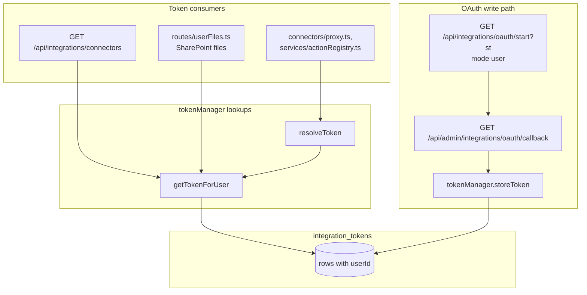

# Integration OAuth and token scopes

The provider-side setup (app registration, redirect URI, consent) is in [AZURE_APP_REGISTRATION.md](../AZURE_APP_REGISTRATION.md) and [ATLASSIAN_APP_REGISTRATION.md](../ATLASSIAN_APP_REGISTRATION.md); only the Azure guide carries a sequence diagram of the round trip. This doc covers what the server keeps between the two legs, how a token row is keyed, and which code reads which rows. How the tokens are encrypted is in [secrets-and-encryption-keys.md](secrets-and-encryption-keys.md).

## Start and callback

- **Start.** `GET /api/integrations/oauth/start` is the only route that begins a flow (`server/src/routes/integrations.ts:211#"oauth/start"`). The browser reaches it by navigation, which cannot send an `Authorization` header, and the session JWT is never accepted in the query (a `token` parameter is ignored and the request gets 401). The client first calls `POST /api/integrations/oauth/start-token` with the header (`server/src/routes/integrations.ts:191#"oauth/start-token"`) and navigates with the returned `st` token: bound to one user, one provider and one scope, valid for 120 seconds, single use, usable only in the browser that minted it, and verifiable only for this purpose (see [auth-and-authz-boundaries.md](auth-and-authz-boundaries.md)). Both routes end in `requireHuman`, which decides on the resolved `userType`, not on the header text: a `byoa_` agent token (with or without `Bearer`, which `authenticate` both accepts) and an agent user's own JWT resolve to a non-HUMAN user and get 403 (`server/src/routes/integrations.ts:191#"requireHuman"`, `server/src/routes/integrations.ts:211#"requireHuman"`). Before this change the header path of the start route also let agents through; that is now refused too. `authenticateOAuthStart` verifies `st` against the `provider` and `scope` of the request, spends it and checks the start cookie (next bullet), and loads the user, refusing a missing or inactive one (`server/src/routes/integrations.ts:131#"clearOAuthStartCookie"`, `server/src/routes/integrations.ts:138#"isActive"`); a request that does carry an `Authorization` header goes through `authenticate` instead and has no `st` and no start cookie. `provider` must be `microsoft` or `atlassian` (`server/src/routes/integrations.ts:215#"Unknown provider"`); `scope` is any string and defaults to `default` (`server/src/routes/integrations.ts:98#"src.scope"`). The state it creates always has `mode` `user` (`server/src/routes/integrations.ts:223#"mode:"`).
- **Start cookie (the `st` is bound to the minting browser).** `st` travels in a URL, so on its own it would let an attacker mint a token under their own session and hand the triologue start URL to a victim, whose consent would then store the victim's provider tokens under the attacker's user. `POST /oauth/start-token` therefore also sets the cookie `oauth_start_<first 16 hex of SHA-256(token)>` (HttpOnly, SameSite=Strict, host-only without `Domain`, `Path` `/api/integrations/oauth/start`, `Max-Age` the token's remaining life, `Secure` exactly when `APP_URL` starts with `https:`) and keeps only the SHA-256 of its random value next to the token in a module-level `Map` (`server/src/routes/integrations.ts:206#"setOAuthStartCookie("`, `server/src/services/integrationOAuth.ts:97-102#"httpOnly: true"`, `server/src/services/integrationOAuth.ts:120#"oauthStartBindings.set"`). `GET /oauth/start` removes that entry first, so the token is spent whatever the answer, and then compares the presented cookie by hash in constant time; a missing cookie, a wrong value, the secret of another mint, and a token with no entry (replay, restart, other instance) all get the 401 of an invalid `st`, and the start cookie is cleared on every response for that token (`server/src/services/integrationOAuth.ts:166#"crypto.timingSafeEqual(presentedHash, expectedHash)"`). SameSite=Strict still sends the cookie on the app's own top-level navigation from the settings page to the start route (same site) and withholds it on any cross-site navigation; the client sends the mint request with `credentials: "include"` so the cookie is also stored when the API sits on another origin of the same site (`VITE_API_URL`). Mints for the same user, provider and scope inside one second are byte-identical, so a second mint replaces the first one's secret and cookie, and a double click on the start navigation counts as a replay: the user starts again from the page. The entries are swept at their expiry. Like the nonce map this is process memory: after a restart, or on a second API instance, an outstanding token is refused and the user starts again.
- **Flow cookie (the callback is bound to the starting browser).** The state alone does not say which browser completes the flow, so the start route also hands the browser a random secret as the cookie `oauth_bind_<nonce>` (HttpOnly, SameSite=Lax, host-only, `Max-Age` 600 seconds, `Path` the pathname of the redirect URI of that provider, so it follows the `*_REDIRECT_URI` override; `Secure` exactly when `APP_URL` starts with `https:`, because `req.secure` is false behind the Traefik and nginx chain), and the nonce entry keeps only its SHA-256 (`server/src/services/integrationOAuth.ts:209#"export function setOAuthBindingCookie"`, `server/src/services/integrationOAuth.ts:186#"httpOnly: true"`, `server/src/routes/integrations.ts:227#"setOAuthBindingCookie("`). The name carries the nonce, so two flows in two tabs do not overwrite each other.
- **Canonical host.** Both cookies are host-only, and the provider sends the browser back to the host of the redirect URI, so the whole flow has to run on that host (www versus apex are different hosts, see [HTTPS-SETUP.md](../HTTPS-SETUP.md)). A request on another host is refused, never redirected: a pre-redirect would have carried the flow across hosts without the start-cookie check. `POST /oauth/start-token` answers 409 with `canonicalOrigin` and a message naming that origin, which the app shows through its normal error line, and mints nothing; `GET /oauth/start` sends a header request the same 409 and a browser navigation back to `/settings/connections?error=wrong_host`, which the connections page shows as its generic failure (`server/src/routes/integrations.ts:159#"function wrongHostOrigin"`, `server/src/routes/integrations.ts:173#"const requireCanonicalHost"`). The origin comes from configuration (the override, else `APP_URL`), never from request headers; only host names are compared (cookies ignore port and scheme), so `localhost:4000` against `localhost:4001` passes. A user on a non-canonical host must open triologue on the canonical host to connect.
- **State nonce.** `createOAuthState` stores `{ provider, scope, userId, mode, targetPath, bindingHash }` under a random nonce in a module-level `Map` (`server/src/services/integrationOAuth.ts:25#"new Map<string, OAuthNonceData>"`, `server/src/services/integrationOAuth.ts:65#"oauthNonces.set(nonce"`) and sends only provider, scope and nonce to the provider, base64url-encoded (`server/src/services/integrationOAuth.ts:77#"base64url"`). A sweep every minute drops entries older than ten minutes and start bindings past their expiry (`server/src/services/integrationOAuth.ts:51#"setInterval(() => sweepOAuthState()"`); `consumeOAuthState` itself does not compare the age, so an entry lives between ten and eleven minutes. The nonce is single use: it is deleted on the first lookup, before the cookie is checked, so a refused callback cannot be retried with the right cookie, and a provider or scope mismatch then fails (`server/src/services/integrationOAuth.ts:281#"oauthNonces.delete(parts.nonce)"`, `server/src/services/integrationOAuth.ts:283#"nonceData.provider !== parts.provider"`). Because the map is process memory, a restart or a second API instance between start and callback ends in `invalid_state`.
- **Callback.** `GET /api/admin/integrations/oauth/callback` has no `authenticate` middleware; the user comes from the nonce, and the nonce is honoured only for the browser that holds its cookie (`server/src/routes/admin.ts:351#"integrations/oauth/callback"`, `server/src/routes/admin.ts:361-362#"invalid_state"`). `consumeOAuthState` hashes the presented cookie and compares it with the stored hash in constant time; a missing, empty or wrong cookie, and the cookie of another flow, give the same `invalid_state` redirect as an unknown nonce, with nothing stored and nothing sent to the provider (`server/src/services/integrationOAuth.ts:293#"crypto.timingSafeEqual(presentedHash, expectedHash)"`). The callback expires the cookie (same name, path and attributes) before it decides anything, so every redirect it sends, success or error, carries the clearing header, and it marks the response `no-store` (`server/src/routes/admin.ts:356#"clearOAuthBindingCookie(res, state)"`). It then exchanges the code and calls `storeToken` with `userId` set to the nonce's user when `mode` is `user`, and `null` otherwise (`server/src/routes/admin.ts:388-393#"nonceData.mode === 'user'"`, `server/src/routes/admin.ts:442-447#"nonceData.mode === 'user'"`). Since no start route creates `admin` mode, every token the callback stores today is a personal one. The tenant-wide start route was removed together with the admin connector UI; the `admin` branch of `OAuthMode` is what remains of it. On a failed token exchange the redirect still carries the first 200 characters of the provider's answer in `detail`.
- **What the two cookies close, and what stays open.** An attacker who starts a flow under their own session and gives the provider authorize URL to a victim fails at the callback (the victim holds no flow cookie for that nonce); an attacker who gives the victim the triologue start URL with their own `st` fails at the start (the victim holds no start cookie for that token), and the token is spent either way. What remains: a cookie planted from a sibling subdomain of the same site (cookie tossing: the attacker knows their own secret, so a Domain-scoped cookie of the right name would pass; `__Host-` names would need Path `/`), and the per-process state above.
- **Redirect URI.** Both legs, the flow cookie `Path` and the canonical-host check use `MICROSOFT_REDIRECT_URI` / `ATLASSIAN_REDIRECT_URI`, falling back to `${APP_URL}/api/admin/integrations/oauth/callback`, through one function (`server/src/services/integrationOAuth.ts:177#"/api/admin/integrations/oauth/callback"`). Which input wins: the override, when set, decides the flow cookie `Path`, the host the flow must run on and the origin named in the refusal; `Secure` (both cookies) comes from `APP_URL` alone; the request host decides only whether the refusal happens.

## How a token row is keyed

`storeToken` writes one `IntegrationToken` per `(provider, scope, tenantId, userId)`: a personal token goes through `upsert` on that unique key (`server/src/services/tokenManager.ts:188-189#"provider_scope_tenantId_userId"`); a tenant-wide token (`userId` null) uses a serializable find-then-write, because Postgres treats NULLs as distinct in the unique index (`server/src/services/tokenManager.ts:138#"if (userId === null)"`). `tenantId` defaults to `default` (`server/src/services/tokenManager.ts:114#"tokens.tenantId || 'default'"`) and is set by the callback:

- Microsoft: `MICROSOFT_TENANT_ID`, or `common` (`server/src/routes/admin.ts:370#"MICROSOFT_TENANT_ID"`).
- Atlassian: the `id` (cloudId) of the first site in `accessible-resources`, or `default` when that call fails (`server/src/routes/admin.ts:433-435#"resources[0].id"`). Jira actions take `cloudId` as an input in their URL template (`server/src/connectors/definitions/jira.yaml:19#"{{cloudId}}"`), so the stored value does not pick the site a request goes to.

No reader passes a `tenantId`, so lookups ignore it and take the caller's newest matching row (`server/src/services/tokenManager.ts:202-203#"orderBy: { createdAt: 'desc' }"`).

## Scope keys

The scope key is a free string that ties a connector definition to its token rows; the OAuth scopes sent to the provider are hard-coded per key in `buildOAuthAuthorizeUrl`:

| Key | Used by | Provider scopes requested |
|---|---|---|
| `graph` | `sharepoint.yaml` (`server/src/connectors/definitions/sharepoint.yaml:9-10#"scope: graph"`), `userFiles.ts` | `Files.ReadWrite.All Sites.Read.All offline_access` (`server/src/services/integrationOAuth.ts:320#"Files.ReadWrite.All Sites.Read.All offline_access"`) |
| `jira` | `jira.yaml` (`server/src/connectors/definitions/jira.yaml:9-10#"scope: jira"`) | `read:jira-work write:jira-work offline_access` (`server/src/services/integrationOAuth.ts:331#"read:jira-work write:jira-work offline_access"`) |
| `teams` | no reader | `Team.ReadBasic.All ChannelMessage.Read.All ChannelMessage.Send offline_access` (`server/src/services/integrationOAuth.ts:319#"ChannelMessage.Send"`) |

Every Atlassian start requests the Jira scopes whatever the key. A connector YAML carries no scope list: the `requiredScopes` field it used to declare was read by no code and is gone, so the requested scopes live only in `buildOAuthAuthorizeUrl`.

## Who reads which rows

`getTokenForUser` reads only the caller's rows (`server/src/services/tokenManager.ts:202#"where: { provider, scope, userId,"`). `resolveToken` returns that token when it has a `userId` and null otherwise; it has no tenant-wide fallback (`server/src/services/tokenManager.ts:227-228#"return getTokenForUser(provider, scope, userId, tenantId)"`). No code reads a row whose `userId` is null, and no current route writes one, so the chart has a single row set.

- File browsing uses only the personal token (`server/src/routes/userFiles.ts:87-88#"getTokenForUser("`).
- Connector calls resolve for the task creator (`server/src/connectors/proxy.ts:258-263#"taskCreatorId,"`), and the action lists built for agents resolve for the task creator or the user (`server/src/services/actionRegistry.ts:129-132#"taskCreatedBy,"`, `server/src/services/actionRegistry.ts:173-176#"userId,"`).
- The connections listing reports a connector from the user's own row only (`server/src/routes/integrations.ts:31-35#"item.userId === userId"`): its `status` and `expiresAt` give `connected`, `expiring`, `expired` or `error`, and `connectionScope` is `user`. A tenant-wide row (`userId` null) is ignored, so a connector with only such a row is `disconnected` with no `connectionScope`; the response has no global-fallback field. The personal token check uses `getTokenForUser` (`server/src/routes/integrations.ts:60#"getTokenForUser("`).
- A user revokes only their own rows: `DELETE /api/integrations/by-id/:id` answers 404 unless the row's `userId` is the caller, and sets `status` `revoked` (`server/src/routes/integrations.ts:243#"Integration not found"`, `server/src/routes/integrations.ts:248#"data: { status:"`).

## Refresh

`getTokenForUser` refreshes an expired row inline, and `refreshExpiring` refreshes active rows that expire within ten minutes (see [secrets-and-encryption-keys.md](secrets-and-encryption-keys.md)). A failed refresh sets `status` `error` and adds `error` and `errorAt` to the metadata the row already has (`server/src/services/tokenManager.ts:312-313#"...base"`). The Microsoft refresh handler uses the tenant in the row's `tenantId` column, and `common` when the column is empty or holds the `default` placeholder (`server/src/services/tokenManager.ts:324#"token.tenantId !== 'default'"`); the callback stores the tenant there (`server/src/routes/admin.ts:392#"tenantId,"`), so a single-tenant app registration refreshes against its own tenant.

## Teams

- The webhook `POST /api/teams/webhook` answers 503 while `TEAMS_BOT_SECRET` is unset and 401 unless the bearer equals it, compared in constant time (`server/src/integrations/teams/teamsBot.ts:33-36#"Webhook not configured"`, `server/src/integrations/teams/teamsBot.ts:25-29#"crypto.timingSafeEqual(presented, expected)"`).
- Channel-to-room mappings are set by admins through `/api/teams/mappings` and kept in a module-level `Map`, as is the Teams-user cache (`server/src/integrations/teams/teamsBot.ts:85#"requireAdmin"`, `server/src/integrations/teams/teamsMapping.ts:15-16#"const userMappings = new Map"`). A restart drops every mapping, after which inbound messages are logged and dropped (`server/src/integrations/teams/teamsSync.ts:11-13#"No mapping for Teams channel"`).
- An inbound sender without a user gets a `HUMAN` guest user named `teams_` plus the first 12 characters of the Teams user id, with `canTriggerAI` true (`server/src/integrations/teams/teamsMapping.ts:49-55#"canTriggerAI: true"`).
- Nothing posts to Teams. `POST /api/agents/message` used to call a Teams send for every agent message, which read a tenant-wide `graph` token that no route writes and that was requested without `ChannelMessage.Send`; the call and the tenant-wide readers behind it were removed. Only the `teams` scope key requests `ChannelMessage.Send`, and no connector definition uses that key.

## What breaks it

- Adding `authenticate` to the callback: the provider redirect carries no `Authorization` header; the nonce is the binding to the user, and the flow cookie binds the nonce to the browser.
- Dropping either cookie check, changing a cookie's `Path`, `SameSite` or host scope, or serving the flow on a host other than the redirect URI's: the flow is then refused for everyone, or accepted for a browser that did not start it. A proxy that rewrites `Host` so it never equals the redirect-URI host refuses every start with `wrong_host`.
- Running more than one API instance, or restarting between start and callback: the nonce map is per process.
- Adding a connector with a new scope key without adding its provider scopes to `buildOAuthAuthorizeUrl`: Microsoft keys other than `teams` get the SharePoint scopes, and every Atlassian key gets the Jira scopes.
- Expecting a tenant-wide token to be used: no current route creates one, and no lookup reads a row whose `userId` is null.
