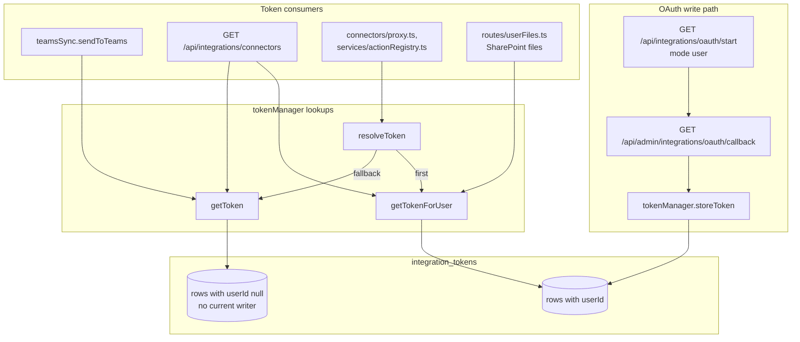

# Integration OAuth and token scopes

The provider-side setup (app registration, redirect URI, consent) is in [AZURE_APP_REGISTRATION.md](../AZURE_APP_REGISTRATION.md) and [ATLASSIAN_APP_REGISTRATION.md](../ATLASSIAN_APP_REGISTRATION.md); only the Azure guide carries a sequence diagram of the round trip. This doc covers what the server keeps between the two legs, how a token row is keyed, and which code reads which rows. How the tokens are encrypted is in [secrets-and-encryption-keys.md](secrets-and-encryption-keys.md).

## Start and callback

- **Start.** `GET /api/integrations/oauth/start` is the only route that begins a flow (`server/src/routes/integrations.ts:109#"oauth/start"`). The browser reaches it by navigation, so a `token` query parameter is promoted to the `Authorization` header, and a `byoa_` agent token there is refused (`server/src/routes/integrations.ts:100-102#"Agent tokens cannot start an OAuth flow"`). `provider` must be `microsoft` or `atlassian` (`server/src/routes/integrations.ts:115-116#"Unknown provider"`); `scope` is any string and defaults to `default` (`server/src/routes/integrations.ts:113#"req.query.scope"`). The state it creates always has `mode` `user` (`server/src/routes/integrations.ts:120-124#"mode:"`).
- **State nonce.** `createOAuthState` stores `{ provider, scope, userId, mode, targetPath }` under a random nonce in a module-level `Map` (`server/src/services/integrationOAuth.ts:15#"new Map"`, `server/src/services/integrationOAuth.ts:36-37#"oauthNonces.set(nonce"`) and sends only provider, scope and nonce to the provider, base64url-encoded (`server/src/services/integrationOAuth.ts:42-48#"base64url"`). A sweep every minute drops entries older than ten minutes (`server/src/services/integrationOAuth.ts:17-24#"}, 60 * 1000)"`); `consumeOAuthState` itself does not compare the age, so an entry lives between ten and eleven minutes. The nonce is single use: it is deleted on the first lookup, and a provider or scope mismatch then fails (`server/src/services/integrationOAuth.ts:61-66#"oauthNonces.delete(nonce)"`, `server/src/services/integrationOAuth.ts:68#"nonceData.provider !== provider"`). Because the map is process memory, a restart or a second API instance between start and callback ends in `invalid_state`.
- **Callback.** `GET /api/admin/integrations/oauth/callback` has no `authenticate` middleware; the user comes from the nonce (`server/src/routes/admin.ts:351#"integrations/oauth/callback"`, `server/src/routes/admin.ts:356-357#"invalid_state"`). It exchanges the code and calls `storeToken` with `userId` set to the nonce's user when `mode` is `user`, and `null` otherwise (`server/src/routes/admin.ts:383-388#"nonceData.mode === 'user'"`, `server/src/routes/admin.ts:437-442#"nonceData.mode === 'user'"`). Since no start route creates `admin` mode, every token the callback stores today is a personal one. The tenant-wide start route was removed together with the admin connector UI; the `admin` branch of `OAuthMode` is what remains of it.
- **Redirect URI.** Both legs use `MICROSOFT_REDIRECT_URI` / `ATLASSIAN_REDIRECT_URI`, falling back to `${APP_URL}/api/admin/integrations/oauth/callback` (`server/src/services/integrationOAuth.ts:91-93#"/api/admin/integrations/oauth/callback"`).

## How a token row is keyed

`storeToken` writes one `IntegrationToken` per `(provider, scope, tenantId, userId)`: a personal token goes through `upsert` on that unique key (`server/src/services/tokenManager.ts:187-188#"provider_scope_tenantId_userId"`); a tenant-wide token (`userId` null) uses a serializable find-then-write, because Postgres treats NULLs as distinct in the unique index (`server/src/services/tokenManager.ts:137#"if (userId === null)"`). `tenantId` defaults to `default` (`server/src/services/tokenManager.ts:113#"tokens.tenantId || 'default'"`) and is set by the callback:

- Microsoft: `MICROSOFT_TENANT_ID`, or `common` (`server/src/routes/admin.ts:365#"MICROSOFT_TENANT_ID"`).
- Atlassian: the `id` (cloudId) of the first site in `accessible-resources`, or `default` when that call fails (`server/src/routes/admin.ts:428-430#"resources[0].id"`). Jira actions take `cloudId` as an input in their URL template (`server/src/connectors/definitions/jira.yaml:22#"{{cloudId}}"`), so the stored value does not pick the site a request goes to.

No reader passes a `tenantId`, so lookups ignore it and take the newest matching row (`server/src/services/tokenManager.ts:194-197#"orderBy: { createdAt: 'desc' }"`).

## Scope keys

The scope key is a free string that ties a connector definition to its token rows; the OAuth scopes sent to the provider are hard-coded per key in `buildOAuthAuthorizeUrl`:

| Key | Used by | Provider scopes requested |
|---|---|---|
| `graph` | `sharepoint.yaml` (`server/src/connectors/definitions/sharepoint.yaml:9-10#"scope: graph"`), `userFiles.ts`, Teams outbound | `Files.ReadWrite.All Sites.Read.All offline_access` (`server/src/services/integrationOAuth.ts:94-97#"Files.ReadWrite.All Sites.Read.All offline_access"`) |
| `jira` | `jira.yaml` (`server/src/connectors/definitions/jira.yaml:9-10#"scope: jira"`) | `read:jira-work write:jira-work offline_access` (`server/src/services/integrationOAuth.ts:110#"read:jira-work write:jira-work offline_access"`) |
| `teams` | no reader | `Team.ReadBasic.All ChannelMessage.Read.All ChannelMessage.Send offline_access` (`server/src/services/integrationOAuth.ts:94-96#"ChannelMessage.Send"`) |

Every Atlassian start requests the Jira scopes whatever the key. The `requiredScopes` list in a connector YAML is declared in the type (`server/src/connectors/types.ts:31#"requiredScopes"`) but read by no code, so editing it changes nothing that is requested.

## Who reads which rows

`getTokenForUser` reads only the caller's rows, `getToken` only rows with `userId` null, and `resolveToken` tries the first and falls back to the second (`server/src/services/tokenManager.ts:216-217#"where: { provider, scope, userId,"`, `server/src/services/tokenManager.ts:196#"userId: null"`, `server/src/services/tokenManager.ts:237-243#"return getToken(provider, scope, tenantId)"`). The chart shows which consumer uses which lookup, and that nothing currently writes the tenant-wide rows.

- File browsing uses only the personal token (`server/src/routes/userFiles.ts:87-88#"getTokenForUser("`).
- Connector calls resolve for the task creator (`server/src/connectors/proxy.ts:258-263#"taskCreatorId,"`), and the action lists built for agents resolve for the task creator or the user (`server/src/services/actionRegistry.ts:129-132#"taskCreatedBy,"`, `server/src/services/actionRegistry.ts:173-176#"userId,"`).
- Teams outbound uses only the tenant-wide `graph` token (`server/src/integrations/teams/teamsSync.ts:50#"getToken('microsoft', 'graph')"`). `registry.listActiveConnectors` also reads only tenant-wide rows (`server/src/connectors/registry.ts:77-80#"getToken(def.auth.provider"`) and has no caller.
- The connections listing reports the personal row first and the tenant-wide one as `hasGlobalFallback` (`server/src/routes/integrations.ts:52-54#"getToken(definition.auth.provider"`, `server/src/routes/integrations.ts:62#"getTokenForUser("`).
- A user revokes only their own rows: `DELETE /api/integrations/by-id/:id` answers 404 unless the row's `userId` is the caller, and sets `status` `revoked` (`server/src/routes/integrations.ts:140-141#"Integration not found"`, `server/src/routes/integrations.ts:144-146#"data: { status:"`).

## Refresh

`getToken`/`getTokenForUser` refresh an expired row inline, and `refreshExpiring` refreshes active rows that expire within ten minutes (see [secrets-and-encryption-keys.md](secrets-and-encryption-keys.md)). A failed refresh sets `status` `error` and replaces `metadata` with the error (`server/src/services/tokenManager.ts:325-328#"status: 'error'"`). The Microsoft refresh handler reads the tenant from `metadata.tenantId` and otherwise uses `common` (`server/src/services/tokenManager.ts:334#"|| 'common'"`); the callback stores the tenant in the `tenantId` column and passes no metadata, so Microsoft refreshes always go to the `common` endpoint.

## Teams

- The webhook `POST /api/teams/webhook` answers 503 while `TEAMS_BOT_SECRET` is unset and 401 unless the bearer equals it, compared in constant time (`server/src/integrations/teams/teamsBot.ts:33-36#"Webhook not configured"`, `server/src/integrations/teams/teamsBot.ts:25-29#"crypto.timingSafeEqual(presented, expected)"`).
- Channel-to-room mappings are set by admins through `/api/teams/mappings` and kept in a module-level `Map`, as is the Teams-user cache (`server/src/integrations/teams/teamsBot.ts:85#"requireAdmin"`, `server/src/integrations/teams/teamsMapping.ts:15-16#"const userMappings = new Map"`). A restart drops every mapping, after which inbound messages are logged and dropped (`server/src/integrations/teams/teamsSync.ts:12-14#"No mapping for Teams channel"`).
- An inbound sender without a user gets a `HUMAN` guest user named `teams_` plus the first 12 characters of the Teams user id, with `canTriggerAI` true (`server/src/integrations/teams/teamsMapping.ts:56-62#"canTriggerAI: true"`).
- Outbound, `POST /api/agents/message` calls `sendToTeams` for every agent message (`server/src/routes/agents.ts:2373#"await sendToTeams("`); it returns early when the room has no mapping or no tenant-wide `graph` token exists. The `graph` token is requested without `ChannelMessage.Send`, which only the unused `teams` key requests.

## What breaks it

- Adding `authenticate` to the callback: the provider redirect carries no `Authorization` header; the nonce is the binding to the user.
- Running more than one API instance, or restarting between start and callback: the nonce map is per process.
- Adding a connector with a new scope key without adding its provider scopes to `buildOAuthAuthorizeUrl`: Microsoft keys other than `teams` get the SharePoint scopes, and every Atlassian key gets the Jira scopes.
- Relying on tenant-wide tokens for Teams or for the `resolveToken` fallback: no current route creates them.
